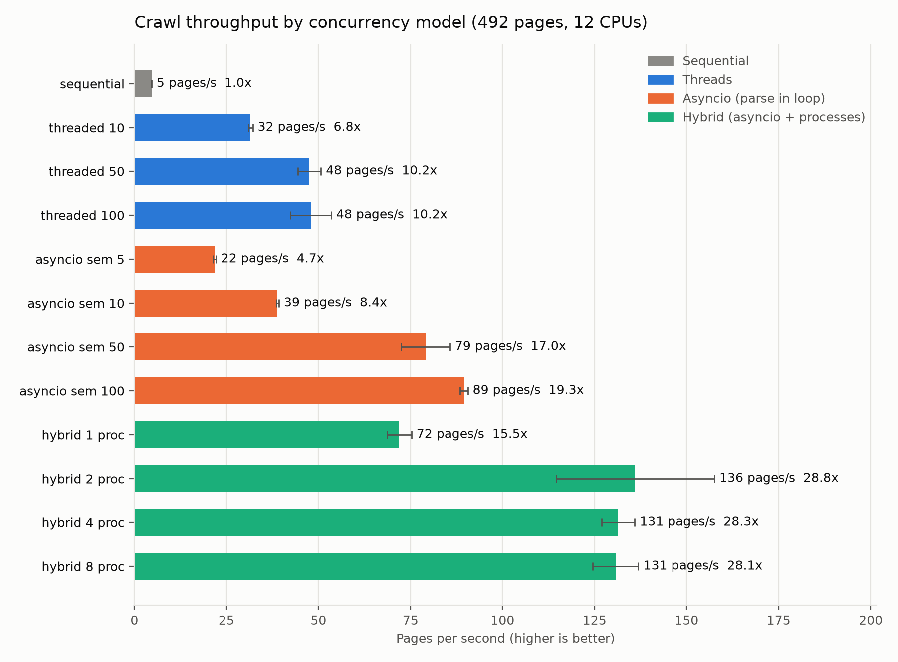
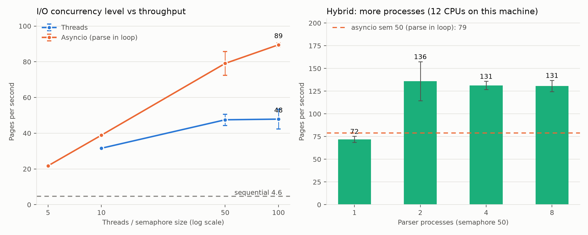

# WebPulse

A concurrent web monitor in Python: it crawls product pages, parses them, stores
every price in SQLite and reports which prices changed since the previous crawl.
The project's goal is to **measure what each concurrency model actually buys**:
sequential, threads, asyncio, and a hybrid of asyncio and multiprocessing.

## The idea

A crawler does two different kinds of work:

| Stage | Bound by | Right tool |
|---|---|---|
| Download pages | waiting on the network (I/O) | `asyncio` (or threads) |
| Parse HTML | the CPU | `multiprocessing` (processes, not threads: the GIL) |
| Write results | one SQLite writer at a time | a dedicated writer thread + `queue.Queue` |

```
                      +--------------------+
 seeds ──► asyncio ───► html ──► process pool ──► parsed page ──┐
           fetch        (I/O)    (CPU: parse_page)              │ on_page()
           Semaphore                                            ▼
                                                   queue.Queue ──► writer thread ──► SQLite
                                                                                     │
                                          change detector (SQL) ◄── next crawl ◄─────┘
```

## Project layout

| File | Role |
|---|---|
| `mock_server.py` | Local e-commerce site: 500 products, 20 per listing page, 50-300 ms latency, ~60 KB pages, `robots.txt` (disallows `/admin/`), `--epoch N` changes ~20% of prices per epoch |
| `config.py` | Every tunable value in one place |
| `parser.py` | `parse_page(html, url)`: title, price, links, word stats. Top-level function returning a plain dict, so it can be sent to a process pool |
| `sequential.py` | Baseline: one request at a time (`requests`) |
| `threaded.py` | `ThreadPoolExecutor` crawler (`--workers`) |
| `fetcher.py` | asyncio + aiohttp crawler: `Semaphore`, timeouts, retries with exponential backoff (`--concurrency`) |
| `hybrid.py` | asyncio fetch + `ProcessPoolExecutor` parse via `run_in_executor` (`--concurrency`, `--processes`) |
| `storage.py` | SQLite writer thread fed by a `queue.Queue`; a `Lock` protects the shared counters |
| `detector.py` | Price change detection between crawls (SQL) |
| `main.py` | Command line: `crawl`, `changes`, `history` |
| `benchmark.py` | Runs every configuration with repetitions; writes `results/` |
| `charts.py` | Draws the charts from `results/benchmark.json` |

All four crawlers share one contract:
`crawl(seeds, max_pages, max_depth, ...) -> (results, stats)`, with an optional
`on_page` callback used to stream pages to storage.

## Setup

Python 3.11+.

```bash
python -m venv .venv
source .venv/bin/activate          # Windows: .venv\Scripts\activate
pip install -r requirements.txt
pip install matplotlib             # only needed for charts.py
```

## Run it

Terminal 1, the mock server:

```bash
python mock_server.py              # add --epoch 1 for a version with changed prices
```

Terminal 2:

```bash
python main.py crawl                                   # hybrid mode, defaults
python main.py crawl --mode threaded --workers 20 --max-pages 500
python main.py crawl --mode asyncio --concurrency 100
python main.py crawl --mode hybrid --concurrency 50 --processes 4 --max-pages 500
python main.py changes --min-change 10                 # changes from the latest crawl
python main.py history http://127.0.0.1:8000/product/7
```

Each crawler also runs on its own (`python fetcher.py --concurrency 50`, ...).

### Seeing price changes

```bash
python mock_server.py --epoch 0        # terminal 1
python main.py crawl --max-pages 500   # terminal 2: stores the baseline
# stop the server, restart it with --epoch 1
python main.py crawl --max-pages 500   # compares with the first crawl
```

With 492 pages (487 with a price) the second crawl reports 104 changed prices, which
matches the mock server's own price function exactly.

### Checks every mode must pass

For the default setup (`MAX_DEPTH 4`, 500 pages): **492 pages, 487 with a price,
1 page skipped by `robots.txt`**, and the same list of URLs in every mode. The
benchmark verifies this on every run.

## Benchmark

```bash
python benchmark.py            # full run: starts its own mock server, ~10 minutes
python benchmark.py --quick    # 100-page smoke run
python charts.py               # results/throughput.png and results/scaling.png
```

It runs sequential, threads (10/50/100), asyncio semaphore (5/10/50/100) and
hybrid with 1/2/4/8 processes (semaphore 50), several repetitions each, and reports
mean and standard deviation. Output in `results/`: `benchmark.json` (every run),
`benchmark.csv`, `benchmark.md`.

For meaningful numbers: close heavy programs, run on mains power, and remember the
mock server shares the CPU with the crawler. Hybrid scaling is capped by your
physical core count.

## Results

> Run `python benchmark.py` on your own machine and paste `results/benchmark.md`
> here, together with the two charts below. The numbers depend on the CPU count and
> the Python build, so only the measured values on the machine you report on belong
> in this section.




Measured earlier on the development machine (492 pages, default latency):

| Mode | Time | Pages/s |
|---|---:|---:|
| sequential | 91.6 s | 5.4 |
| threads (10 to 100 workers) | 8.6 to 10 s | 50 to 57 |
| asyncio, semaphore 5 | 18.5 s | 27 |
| asyncio, semaphore 10 | 9.9 s | 50 |
| asyncio, semaphore 50 | 3.2 s | 154 |
| asyncio, semaphore 100 | 3.1 s | 159 |

### What to look for

- **Threads vs asyncio:** both overlap the waiting, but threads cost more per
  request and parsing still holds the GIL. asyncio scales with the semaphore until
  the event loop's single thread is the limit.
- **The asyncio plateau (semaphore 50+):** `parse_page` runs inside the event loop, so
  while one page is parsed no other coroutine runs. This is the bottleneck the hybrid
  removes.
- **Hybrid:** parsing moves to worker processes. The gain grows with how expensive
  parsing is relative to the network wait, and stops at your core count. On a
  2-core machine that also hosts the mock server, expect little or no gain over
  asyncio; check the processes 1/2/4/8 chart on your hardware.

## Design decisions

- **Level-by-level BFS** in every crawler. Processing pages in completion order gave
  wrong depths and lost pages (489 vs 492); levels give the same page set and order
  as the sequential baseline for any worker count.
- **`parse_page` returns a plain dict** and stays a top-level function, so it is
  picklable for the process pool (needed on Windows, where workers use `spawn`).
  Entry points are guarded with `if __name__ == "__main__":`.
- **The semaphore is held only during the request**, not during backoff, so a failing
  URL never blocks a slot. Retries cover network errors, timeouts and 429/5xx, not 404.
- **One writer thread owns the SQLite connection.** Producers only append to a queue
  (never blocks the event loop); the writer commits in batches. A page that fails to
  write is rolled back alone (SAVEPOINT) and counted.
- **Listing pages use `class="item-price"`, product pages `class="price"`**, so price
  statistics only count product pages.
- **Pool start-up is excluded from `elapsed`** in hybrid and reported separately
  (`pool_startup`), so it is not billed to the crawl.

## Possible extensions

A live progress display, a small Flask dashboard over the SQLite file, and a
comparison with free-threaded Python 3.13.